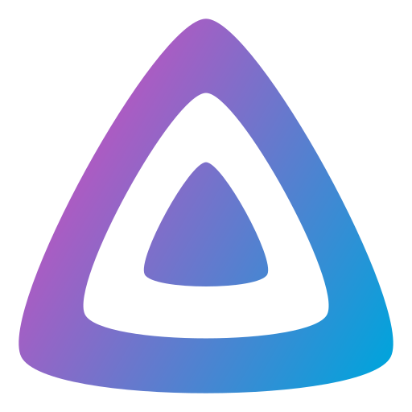

# Jellyfin for Meta Quest 3

*Working title.* A native app for the Meta Quest 3 headset that connects to a [Jellyfin](https://jellyfin.org) media server and turns it into a virtual cinema: browse your library and watch your movies and series on a big screen, in 3D, or in 180 and 360 degrees.

> Unofficial project, not affiliated with the Jellyfin project or with Meta. Work in progress.

## Why

Jellyfin has official apps for phones, TVs, browsers and desktop computers, but none designed for VR headsets. On the Quest 3 today you can open the Jellyfin web client in the browser, or install the Android phone app and use it as a flat window. This project aims at an app built for the headset: a virtual cinema that shows each video in the right way for its format, easy to use with the Quest controllers or with hand tracking, and playing video with the headset's hardware decoders.

## Goals

- Watch in a virtual cinema, with 3D video (side by side, over under) and 180 and 360 video shown in the right mode for each file.
- Connect to a Jellyfin server and sign in without typing passwords in VR.
- Browse libraries: movies, series, continue watching, search.
- Play video smoothly, using the original file whenever the headset can play it and asking the server to convert it only when needed.
- Choose audio and subtitle tracks.
- Keep watch progress in sync with the server and the other Jellyfin apps.
- Download videos to the headset to watch them offline.

The prioritized list of work is in the [backlog](docs/backlog.md).

## Status

Version 0.2.0 runs on the Quest 3: it opens as a normal Quest window and switches to an immersive scene and back, the shell that the cinema will fill ([changelog](CHANGELOG.md)). Next: signing in to a Jellyfin server. The [board](docs/board.md) shows the current state.

## Building

The app is built with Meta Spatial SDK and Kotlin ([ADR-001](docs/decisions/ADR-001-technology-stack.md)). With Android Studio installed and a Quest 3 in developer mode connected to the PC, `./gradlew runOnQuest` builds the app, installs it on the headset and starts it. Details in [docs/architecture.md](docs/architecture.md).

## How the project is run

The work moves in iterations, each one going through research, plan, code, build, test, release, deploy and review. The details are in [docs/process.md](docs/process.md); research results are in [docs/research](docs/research/) and technical decisions in [docs/decisions](docs/decisions/). New to the terms? See the [glossary](docs/glossary.md).

## Requirements

- Meta Quest 3, with developer mode enabled to install the app from a PC.
- A Jellyfin server reachable from the headset (minimum version to be defined).

## License

The code's license is still to be decided ([JQ-014](docs/backlog.md)).

The icon is the [Jellyfin logo](https://commons.wikimedia.org/wiki/File:Jellyfin_-_icon-transparent.svg) by the Jellyfin contributors, licensed under [CC BY-SA 4.0](https://creativecommons.org/licenses/by-sa/4.0/). [docs/assets/jellyfin-icon.svg](docs/assets/jellyfin-icon.svg) is the original; the app's launcher icon (`app/src/main/res/drawable/ic_launcher_foreground.xml`) is an adaptation of it, shared under the same license.
